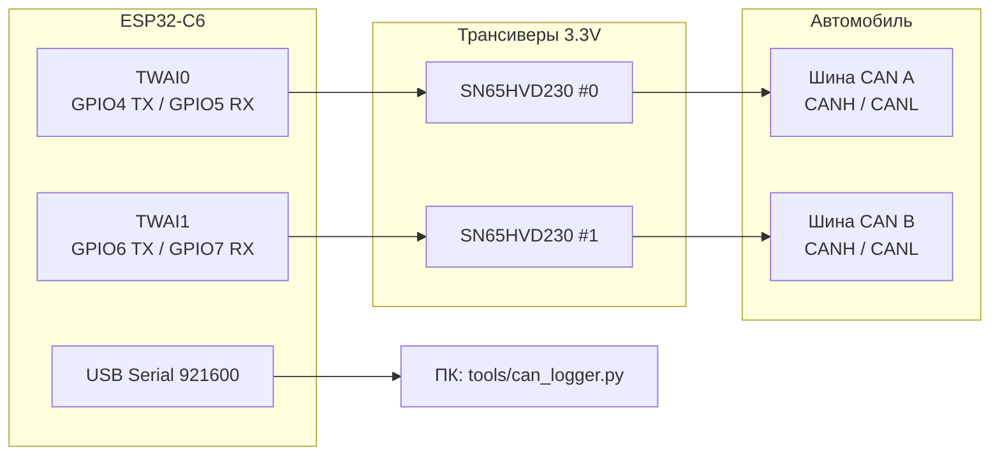

# Схема подключения: ESP32-C6 ↔ SN65HVD230 ↔ CAN автомобиля

ESP32-C6 имеет **два независимых TWAI-контроллера**. На каждый канал — свой модуль **SN65HVD230** (3.3 V).

## Пины по умолчанию (`platformio.ini`)

| Канал | ESP32-C6 TX → HVD230 TXD | ESP32-C6 RX ← HVD230 RXD | Скорость |
|-------|--------------------------|--------------------------|----------|
| CAN0  | GPIO4                    | GPIO5                    | 500 kbit/s |
| CAN1  | GPIO6                    | GPIO7                    | 500 kbit/s |

Пины и bitrate меняются через `build_flags` в `platformio.ini`.

## ASCII-схема

```
                         +3V3 ─────────────────────────┐
                         GND  ──────────────────────┐  │
                                                    │  │
  ESP32-C6                                          │  │
 ─────────                                          │  │
                                                    │  │
  GPIO4 (TWAI0 TX) ──────► TXD  SN65HVD230 #0  CANH ├──┼──► CANH шины A (авто)
  GPIO5 (TWAI0 RX) ◄────── RXD      │          CANL ├──┼──► CANL шины A
                         GND ◄──────┘               │  │
                         VCC ◄──────────────────────┘  │
                         RS  ──► GND (high-speed)      │
                                                       │
  GPIO6 (TWAI1 TX) ──────► TXD  SN65HVD230 #1  CANH ───┼──► CANH шины B (авто)
  GPIO7 (TWAI1 RX) ◄────── RXD      │          CANL ───┼──► CANL шины B
                         GND ◄──────┘                  │
                         VCC ◄─────────────────────────┘
                         RS  ──► GND (high-speed)

  USB ──► питание ESP32 + Serial-лог (921600 baud)
```

## Подробнее по выводам SN65HVD230

| Вывод модуля | Куда |
|--------------|------|
| **VCC** | **3.3 V** ESP32 (не 5 V) |
| **GND** | Общий GND с ESP32 и (по возможности) с массой авто |
| **TXD / CTX** | GPIO TX соответствующего TWAI |
| **RXD / CRX** | GPIO RX соответствующего TWAI |
| **CANH** | CAN High автомобиля |
| **CANL** | CAN Low автомобиля |
| **RS** | На GND — максимальная скорость; либо через ~47 kΩ на GND (slope control, меньше EMI) |

> У разных модулей подписи бывают `CTX`/`CRX` или `TX`/`RX` — это те же TXD/RXD трансивера.

## Две шины автомобиля

Типичный сценарий:

- **CAN0** → High-Speed CAN (силовой/двигатель, часто 500 kbit/s)
- **CAN1** → Comfort / Body / второй HS-контур (125 / 250 / 500 kbit/s — смотри документацию авто)

Подключайся к диагностическому разъёму / жгуту **только** к нужной паре CANH/CANL. Не перепутай с CAN-FD / однопроводным GM-LAN, если они есть в машине.

## Терминаторы 120 Ω

- На штатной шине авто терминаторы **уже стоят** на ECU — **не добавляй** второй 120 Ω «просто так», иначе исказится линия.
- Добавляй 120 Ω между CANH–CANL **только** если ты собираешь отдельный стенд из двух узлов без заводских терминаторов.
- Многие модули SN65HVD230 имеют джампер `120R` — на живой машине его обычно **снимают**.

## Режим прослушивания

Прошивка по умолчанию в **listen-only** (`CAN_LISTEN_ONLY=1`): ESP32 не шлёт ACK и не вмешивается в шину. Для обычного логирования на авто это безопаснее, чем normal-mode.

## Питание и безопасность

1. Питай ESP32 от USB ноутбука; трансиверы от 3.3 V ESP32.
2. Общий GND с автомобилем желателен при длинных проводах (через OBD/массу), но **не** цепляй 12 V на VCC модуля.
3. Скрученная пара CANH/CANL, по возможности короткие провода до трансивера.
4. Зажигание / диагностика — на свой страх и риск; сначала проверь пины мультиметром.

## Mermaid (логика связей)


